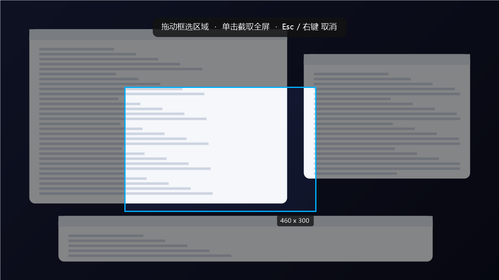

# 悬浮截图 · SnapCopy

[](LICENSE)

> 常驻桌面的截图小工具：框选 → 松开 → 图已经在剪贴板。没有预览窗口，没有编辑器，没有中间步骤。


## 为什么用它

- **零等待**：鼠标一松，图就在剪贴板，`Ctrl+V` 直接粘。
- **零窗口**：不弹预览、不开编辑器、不落文件。
- **常驻**：屏幕角落一枚小按钮，随手点一下就进框选；也可以全局热键。
- **零依赖**：单个 exe，约 40 KB，不需要 .NET SDK、不需要运行时、不需要管理员权限（用系统自带的 .NET Framework 4.x 编译和运行）。

## 界面



<sub>上图为界面示意，非真实桌面内容。</sub>

## 快速开始

1. 拿 `悬浮截图.exe`（仓库根目录，或 Releases 里 `dist/悬浮截图-v1.0.0-win-x64.zip`）。
2. 双击运行。屏幕右下角出现悬浮按钮，托盘出现同款图标。
3. 开始用：

| 操作 | 结果 |
|---|---|
| 点悬浮按钮 / 按 `Ctrl+Alt+S` / 再双击一次 exe | 进入框选 |
| 按住左键拖出矩形 | 只截这块区域 |
| 单击（不拖） | 截整屏 |
| `Esc` 或右键 | 取消 |

松手瞬间图片已经写进剪贴板，直接 `Ctrl+V` 到微信 / QQ / Word / PS / 画图都行。底部会闪一条 0.9 秒的提示（不挡鼠标、不抢焦点），只是确认尺寸。

## 悬浮按钮怎么用

| 操作 | 结果 |
|---|---|
| 左键单击 | 截图 |
| 按住左键拖动 | 挪位置（下次启动还在原处） |
| 右键 | 菜单：截图 / 隐藏悬浮按钮 / 退出 |

- 选「隐藏悬浮按钮」后按钮消失，托盘图标还在，点它能叫回来。
- 要彻底关闭就用菜单或托盘里的「退出」。
- 截图那一刻悬浮按钮会自动隐藏，不会出现在图里。

## 全局热键

默认注册 `Ctrl+Alt+S`。被别的程序占用时，自动依次退到 `Ctrl+Shift+S`、`Ctrl+Alt+A`；实际生效的组合显示在托盘图标的提示里。

## 命令行参数

主要给自检和自动化用，正常使用不需要：

```console
悬浮截图.exe --capture-all                 :: 整屏进剪贴板
悬浮截图.exe --region 100 100 300 200      :: 按坐标裁剪进剪贴板
悬浮截图.exe --toast-test                  :: 预览提示条
悬浮截图.exe --selftest                    :: 框选逻辑回归测试，退出码 0 通过
```

调试用环境变量：`SNAPCOPY_LOG=<文件路径>` 打开日志，`SNAPCOPY_AUTOCAPTURE=1` 启动后自动进入一次框选。

## 构建

需要 Windows 10/11 自带的 .NET Framework 4.x（`C:\Windows\Microsoft.NET\Framework64\v4.0.30319\csc.exe`）。没有 NuGet，没有项目文件，没有 SDK 依赖。

```powershell
powershell -ExecutionPolicy Bypass -File tools\build.ps1     # → dist\SnapCopy.exe
powershell -ExecutionPolicy Bypass -File tools\package.ps1   # → 悬浮截图.exe + dist\悬浮截图-v1.0.0-win-x64.zip
powershell -ExecutionPolicy Bypass -File tools\make-icon.ps1 # → assets\icon.ico
```

## 目录结构

```
悬浮截图/
├── 悬浮截图.exe              # 成品（免安装，绿色）
├── README.md
├── CHANGELOG.md
├── LICENSE                   # MIT
├── src/
│   └── SnapToClipboard.cs    # 全部逻辑：截屏 / 覆盖层 / 剪贴板 / 悬浮按钮 / 托盘 / 热键
├── assets/
│   ├── icon.ico              # 16–256 多尺寸，PNG 压缩条目
│   ├── preview-widget.png
│   └── preview-overlay.png
├── tools/
│   ├── build.ps1             # 调 csc 编译
│   ├── package.ps1           # 改名 + 打 zip
│   └── make-icon.ps1         # GDI+ 画图标
└── dist/
    └── 悬浮截图-v1.0.0-win-x64.zip
```

## 实现说明

- **先快照再遮罩**：进框选时把整屏抓成一张位图当背景，之后画面静止，窗口不会在框选过程中变化。
- **剪贴板持久化**：`Clipboard.SetDataObject(data, copy: true, retry, delay)`，进程退出后图片仍然留在剪贴板；同时写入 `Bitmap` 与 `PNG` 两种格式，兼容更多接收端。
- **DPI 感知**：启动即 `SetProcessDPIAware()`，按物理像素出图。125% 缩放下拿到的是 2560×1440，而不是被虚拟化的 2048×1152。
- **上膛延迟**：覆盖层弹出后 180ms 内不接收点击，避免"点按钮的那一下"漏进来被当成"单击=全屏"。
- **单实例**：命名 Mutex 保证只有一个进程；重复启动的那个通过命名 Event 唤醒已有实例，直接进入截图。

## 已知限制

- 多显示器且各屏缩放比例不同时未做逐屏适配（单屏 125% 正常）。
- 没有开机自启，需要的话把快捷方式放进 `shell:startup`。
- 只支持 Windows（用了 WinForms / GDI+ / Win32 热键）。

## 许可证

MIT，见 [LICENSE](LICENSE)。你可以自由使用、修改、商用、再分发，保留版权声明即可。

<sub>版权人一行目前写的是 `SnapCopy authors`，建议改成你的名字或 GitHub 用户名。</sub>
